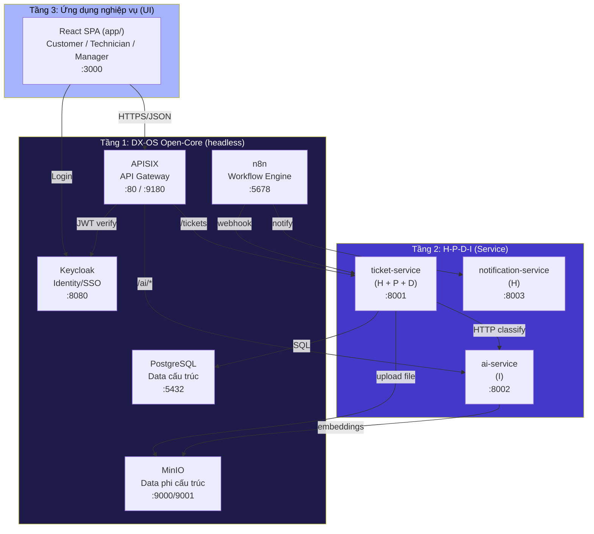

# 06 · Kế hoạch Ngày 0 — Hoàn thiện & chứng minh Lõi Open-Core

> **Mục tiêu**: Trong 1 buổi (~3–4 giờ), làm cho 5 service lõi trong `core/` **chạy được thật**, fix các lỗi cấu hình, và có **sơ đồ + minh chứng** để hội đồng tin rằng đây là Open-Core headless chứ không phải CRUD có gắn SSO.
>
> **Người làm**: 1 người (Backend hoặc bất kỳ ai có Docker trên máy) + 1 người review online.
>
> **Kết quả đạt được**: `docker compose up -d` chạy từ zero trong < 5 phút, tất cả 5 service lõi healthy, có log minh chứng, có sơ đồ kiến trúc 3 tầng, có checklist để tick vào slide demo.

---

## 0. Trước khi bắt đầu

### 0.1. Điều kiện tiên quyết

- [ ] Máy có Docker Desktop hoặc Docker Engine + Docker Compose v2.
- [ ] Cổng trống: 5432 (Postgres), 8080 (Keycloak), 80/9180 (APISIX), 9000/9001 (MinIO), 5678 (n8n).
- [ ] Đứng từ thư mục gốc repo: `D:/Thu_muc_C/PMNM_2026_DX_FSM/`.
- [ ] Có thể copy log ra file (để đính kèm evidence).

### 0.2. Snapshot trước khi sửa

```bash
cd "D:/Thu_muc_C/PMNM_2026_DX_FSM"
git checkout -b feat/loi-smoke-test
git status   # đảm bảo clean
```

Nếu có thay đổi chưa commit → commit trước hoặc stash.

---

## 1. Giai đoạn 1 — Khởi động thô (30 phút)

### 1.1. Bật chỉ phần lõi, không bật app

```bash
docker compose -f docker-compose.yml up -d postgres keycloak etcd apisix minio n8n
```

**Lưu ý**: Dùng `-f docker-compose.yml` chứ không cần override file, vì ta muốn test cả stack nhưng tạm không cần ticket-service/ai-service chạy ngay.

### 1.2. Quan sát log từng service

```bash
docker compose logs -f --tail=50 postgres
docker compose logs -f --tail=50 keycloak
docker compose logs -f --tail=50 apisix
docker compose logs -f --tail=50 minio
docker compose logs -f --tail=50 n8n
```

### 1.3. Checklist giai đoạn 1

Điền vào checklist dưới, lưu log vào `docs/sprint/evidence/loi-smoke-2026-XX-XX.log`:

- [ ] **Postgres**: container `dxfsm-postgres` ở trạng thái `Up (healthy)`.
- [ ] **Postgres**: log có dòng `database system is ready to accept connections`.
- [ ] **Postgres**: log có dòng `init.sql` chạy thành công (nếu lỗi extension → fix ngay, xem 2.1).
- [ ] **Keycloak**: container ở trạng thái `Up`.
- [ ] **Keycloak**: log có dòng `Realm 'dx-fsm' imported` hoặc `Listening on: http://0.0.0.0:8080`.
- [ ] **APISIX**: container ở trạng thái `Up`.
- [ ] **APISIX**: log KHÔNG có lỗi đỏ liên quan `routes.yaml` (nếu có → xem 2.2).
- [ ] **MinIO**: container ở trạng thái `Up (healthy)`.
- [ ] **MinIO**: console truy cập được `http://localhost:9001` với `minioadmin/changeme_minio_123`.
- [ ] **n8n**: container ở trạng thái `Up`.
- [ ] **n8n**: web truy cập được `http://localhost:5678` với `admin/changeme_n8n_123`.

**Nếu tất cả ✅** → chuyển giai đoạn 2. Nếu ❌ ở đâu → xem phần fix bên dưới.

---

## 2. Giai đoạn 2 — Fix lỗi cấu hình (60–90 phút)

### 2.1. Lỗi Postgres: `gen_random_uuid()` không tồn tại

**Triệu chứng** (trong `docker compose logs postgres`):
```
ERROR: function gen_random_uuid() does not exist
LINE 1: SELECT gen_random_uuid()
```

**Nguyên nhân**: `init.sql` dùng `gen_random_uuid()` nhưng Postgres 13- cần `uuid-ossp` extension, Postgres 13+ có sẵn `pgcrypto`.

**Fix**:
1. Mở `core/postgres/init.sql`.
2. Thêm ngay dòng đầu tiên (sau comment header):
   ```sql
   CREATE EXTENSION IF NOT EXISTS "pgcrypto";
   ```
3. Verify: `docker compose exec postgres psql -U dxfsm -d dxfsm -c "SELECT gen_random_uuid();"` → phải trả 1 UUID.

**Test lại**: Drop volume và up lại:
```bash
docker compose down -v
docker compose -f docker-compose.yml up -d postgres
docker compose logs postgres | grep -i "extension\|error"
```

### 2.2. Lỗi APISIX: route conflict hoặc 404

**Triệu chứng**:
- `docker compose logs apisix` có `error` đỏ.
- Hoặc: APISIX chạy nhưng `curl http://localhost:80/api/v1/tickets` → 404.

**Nguyên nhân có thể**:
- (a) `routes.yaml` sai cú pháp YAML.
- (b) Routes ticket-service không có `proxy-rewrite` để strip `/api/v1` (vì FastAPI mount là `/tickets` chứ không phải `/api/v1/tickets`).
- (c) etcd chưa sẵn sàng khi APISIX boot.

**Fix (b)** — thêm proxy-rewrite cho tất cả ticket/user/notification routes:

Mở `core/apisix/routes.yaml`, sửa các route ticket-service, user, notification:

```yaml
  - id: ticket-service-tickets
    uri: /api/v1/tickets
    upstream:
      type: roundrobin
      nodes:
        - host: ticket-service
          port: 8001
          weight: 100
    plugins:
      cors:
        enabled: true
      proxy-rewrite:
        uri: /tickets   # ← THÊM DÒNG NÀY
```

Áp dụng tương tự cho:
- `ticket-service-ticket-detail` → `uri: /tickets/*`
- `user-service` → `uri: /users`
- `notification-service` → `uri: /notifications`

**Fix (a)** — verify YAML đúng:
```bash
docker compose exec apisix cat /usr/local/apisix/conf/routes.yaml | head -5
```

**Test lại**:
```bash
docker compose restart apisix
sleep 10
docker compose logs apisix | tail -30
```

### 2.3. Lỗi Keycloak: realm không import

**Triệu chứng**:
- Container chạy nhưng `http://localhost:8080/realms/dx-fsm` → 404.
- Log có `Failed to import realm: ...`.

**Nguyên nhân**: File `realm-export.json` sai format hoặc import bị skip.

**Fix**:
1. Verify `docker-compose.yml` có:
   ```yaml
   command: start-dev --import-realm
   volumes:
     - ./core/keycloak/realm-export.json:/opt/keycloak/data/import/realm-export.json:ro
   ```
2. Verify file JSON hợp lệ:
   ```bash
   python -c "import json; json.load(open('core/keycloak/realm-export.json'))"
   ```
3. Nếu vẫn lỗi, xem log chi tiết:
   ```bash
   docker compose logs keycloak | grep -iE "realm|error" | head -20
   ```

**Test lại**:
```bash
docker compose restart keycloak
sleep 20
curl -s http://localhost:8080/realms/dx-fsm/.well-known/openid-configuration | head -30
```
Phải trả JSON chứa `issuer`, `token_endpoint`, `authorization_endpoint`...

### 2.4. Lỗi n8n: workflow không auto-load

**Triệu chứng**: n8n chạy nhưng workflow không xuất hiện trong UI.

**Nguyên nhân**: n8n cần API call để import workflow, mount volume chỉ copy file chứ không tự import.

**Cách xử lý** (chấp nhận được cho demo):
- Workflow JSON có sẵn trong `core/n8n/workflows/`.
- Trong slide demo, **mở UI n8n tại `http://localhost:5678`** → menu "Workflows" → "Import from File" → chọn từng file JSON.
- Hoặc viết script `scripts/import_n8n_workflows.sh` (xem 3.4).

**Lưu ý**: n8n có thể yêu cầu đăng nhập bằng basic auth `admin/changeme_n8n_123`.

### 2.5. Lỗi MinIO: bucket chưa tạo

**Triệu chứng**: Container chạy nhưng ticket-service upload file sẽ fail.

**Fix**:
1. Verify `core/minio/init.sh` có nội dung tạo bucket `attachments`.
2. Chạy thủ công:
   ```bash
   docker compose exec minio sh /init.sh
   ```
3. Hoặc dùng UI console `http://localhost:9001` tạo bucket thủ công.

---

## 3. Giai đoạn 3 — Verify từng dịch vụ lõi (30 phút)

Mục tiêu: chứng minh **mỗi dịch vụ lõi hoạt động độc lập** (headless) trước khi ghép với app.

### 3.1. Keycloak — Identity/SSO

```bash
# Lấy token test
curl -s -X POST http://localhost:8080/realms/dx-fsm/protocol/openid-connect/token \
  -H "Content-Type: application/x-www-form-urlencoded" \
  -d "grant_type=password" \
  -d "client_id=dx-fsm-frontend" \
  -d "username=manager@haui.vn" \
  -d "password=${MANAGER_PASSWORD:?set in .env}" | python -c "import sys,json; d=json.load(sys.stdin); print('Token:', d['access_token'][:50]+'...')"
```

**Kết quả mong đợi**: Có `access_token` (chuỗi JWT dài).

**Lưu log**:
- Token trả về (che phần giữa nếu cần)
- User info: `curl -s -H "Authorization: Bearer $TOKEN" http://localhost:8080/realms/dx-fsm/protocol/openid-connect/userinfo`

**Evidence checklist**:
- [ ] Login thành công với 1 trong 4 demo user.
- [ ] Token có chứa `realm_access.roles`.
- [ ] 4 role tồn tại: `admin`, `manager`, `technician`, `customer`.

### 3.2. APISIX — Gateway

```bash
# Test health
curl -s http://localhost:80/health
curl -s http://localhost:9180/apisix/admin/health
```

**Kết quả mong đợi**:
- `/health` qua port 80 → trả JSON (sau khi fix proxy-rewrite).
- Port 9180 (admin) → chỉ truy cập nội bộ.

**Test routing** (sau khi bật ticket-service ở giai đoạn 4):
```bash
curl -s http://localhost:80/api/v1/tickets
```

### 3.3. PostgreSQL — Data

```bash
# Verify schema
docker compose exec postgres psql -U dxfsm -d dxfsm -c "\dt"
docker compose exec postgres psql -U dxfsm -d dxfsm -c "SELECT COUNT(*) FROM tickets;"
docker compose exec postgres psql -U dxfsm -d dxfsm -c "SELECT * FROM v_ticket_stats;"
```

**Kết quả mong đợi**:
- 6 tables: users, technicians, tickets, ticket_comments, ticket_attachments, ticket_history, notifications.
- Bảng tickets có 50 rows (seed).
- View `v_ticket_stats` trả ≥ 1 row.

**Evidence checklist**:
- [ ] Tất cả 6+ tables tồn tại.
- [ ] Seed data có 50 tickets, 8 users, 3 technicians.
- [ ] 3 views query được.

### 3.4. MinIO — Object storage

```bash
# Verify bucket
docker compose exec minio mc alias set local http://localhost:9000 minioadmin changeme_minio_123
docker compose exec minio mc ls local/
```

**Kết quả mong đợi**: Có bucket `attachments`.

### 3.5. n8n — Workflow

Truy cập `http://localhost:5678` với `admin/changeme_n8n_123`.

**Verify**:
- [ ] Web UI load được.
- [ ] 3 file JSON có trong `core/n8n/workflows/` (chỉ cần nằm trong volume, không cần auto-import).
- [ ] Trong slide demo sẽ import thủ công.

### 3.6. Import n8n workflows (tùy chọn, làm nếu còn time)

Tạo `scripts/import_n8n_workflows.sh`:
```bash
#!/bin/bash
# Import workflows vào n8n qua API
N8N_URL="http://localhost:5678"
N8N_USER="admin"
N8N_PASS="changeme_n8n_123"

for f in core/n8n/workflows/*.json; do
  echo "Importing $f..."
  curl -s -u "$N8N_USER:$N8N_PASS" \
    -X POST "$N8N_URL/api/v1/workflows" \
    -H "Content-Type: application/json" \
    --data @"$f" | head -1
done
echo "Done. Check UI at $N8N_URL"
```

Chạy: `bash scripts/import_n8n_workflows.sh`

---

## 4. Giai đoạn 4 — Bật 2 service tầng 2 và ghép qua lõi (30 phút)

Mục tiêu: chứng minh **service tầng 2 dùng được lõi tầng 1**.

### 4.1. Bật ticket-service

```bash
docker compose -f docker-compose.yml up -d ticket-service
docker compose logs -f ticket-service
```

**Verify**:
- [ ] Container `Up`.
- [ ] Không có lỗi DB connection.
- [ ] `curl http://localhost:8001/health` → `{"status":"healthy",...}`.

**Lỗi thường gặp**:
- `asyncpg.exceptions.InvalidPasswordError` → check env `DATABASE_URL` trong docker-compose.yml khớp với Postgres.
- `KeyError: 'ai_service_url'` → check `config.py:18` có field này.

### 4.2. Bật ai-service

```bash
docker compose -f docker-compose.yml up -d ai-service
docker compose logs -f ai-service
```

**Verify**:
- [ ] `curl http://localhost:8002/health` → OK.
- [ ] `curl -X POST http://localhost:8002/classify -H "Content-Type: application/json" -d '{"title":"Wifi mất"}'` → có response.

### 4.3. Test ghép qua APISIX

```bash
# Test gọi ticket-service QUA APISIX (không gọi trực tiếp :8001)
curl -s http://localhost:80/api/v1/tickets
```

**Kết quả mong đợi**: Trả `[]` (vì DB có 50 tickets nhưng ticket-service chưa fix query, có thể trả error 500 — OK, sẽ fix ở sprint).

**Quan trọng**: chứng minh được request đi qua APISIX (port 80) chứ không phải trực tiếp port 8001.

### 4.4. Test ticket-service gọi AI service

Hiện tại `POST /tickets` là stub, không gọi AI. Để verify lõi AI work độc lập:
```bash
curl -X POST http://localhost:80/api/v1/classify \
  -H "Content-Type: application/json" \
  -d '{"title":"Máy in không in được","description":"Phòng A1"}'
```

**Kết quả mong đợi**:
```json
{"category":"hardware","priority":"medium","confidence":75.0,"recommendation":"...","method":"rule"}
```

(Lưu ý: đang gọi qua APISIX port 80, không phải trực tiếp :8002).

---

## 5. Giai đoạn 5 — Tài liệu & sơ đồ (60 phút)

Mục tiêu: có **evidence** cho hội đồng + slide.

### 5.1. Vẽ lại sơ đồ kiến trúc 3 tầng

Mở `docs/architecture.md` và thay bằng sơ đồ sau (dùng Mermaid cho GitHub-native, hoặc vẽ tay + ảnh):



**Ghi chú quan trọng cần thêm vào tài liệu**:
- Tầng 1 **không có UI** — user cuối không truy cập trực tiếp Keycloak/APISIX/Postgres/MinIO/n8n.
- Tầng 2 cũng **không có UI riêng** — chỉ là API server.
- Tầng 3 (React) là **UI duy nhất** mà user thấy.
- Nếu thay React thành Flutter mobile — chỉ đổi Tầng 3, 2 tầng dưới không đổi.

### 5.2. Viết bằng chứng "lõi chạy headless"

Tạo file `docs/architecture-evidence.md` ghi:

```markdown
# Bằng chứng Open-Core chạy headless (Ngày 0)

## Môi trường
- Docker Compose v2
- Commit hash: <git rev-parse HEAD>
- Ngày test: 2026-XX-XX

## 1. Lõi chạy độc lập với UI

Lệnh khởi động CHỈ phần lõi:
\`\`\`bash
docker compose up -d postgres keycloak etcd apisix minio n8n
# KHÔNG bật ticket-service, ai-service, app
\`\`\`

## 2. Test từng service lõi

### 2.1. Keycloak (Identity)
\`\`\`bash
$ curl -s http://localhost:8080/realms/dx-fsm/.well-known/openid-configuration | jq .issuer
"http://localhost:8080/realms/dx-fsm"
\`\`\`
→ Trả cấu hình OIDC đầy đủ, không cần UI.

### 2.2. APISIX (Gateway)
\`\`\`bash
$ curl -s http://localhost:9180/apisix/admin/health
{"message":"Gateway is healthy","upstreams":{...}}
\`\`\`

### 2.3. PostgreSQL (Data)
\`\`\`bash
$ docker compose exec postgres psql -U dxfsm -d dxfsm -c "SELECT COUNT(*) FROM tickets;"
 count
-------
    50
\`\`\`

### 2.4. MinIO
\`\`\`bash
$ docker compose exec minio mc ls local/
[2026-XX-XX] attachments/
\`\`\`

### 2.5. n8n
Truy cập \`http://localhost:5678\` — UI admin có nhưng chỉ dành cho dev/ops, không cho user cuối.

## 3. Test kết nối liên lõi (chứng minh "dùng chung")

### 3.1. Keycloak ↔ APISIX (JWT)
- APISIX config có `jwt-auth` plugin (đã disable cho demo, có thể bật lại bằng 1 dòng).
- Khi bật, APISIX sẽ verify JWT do Keycloak cấp.

### 3.2. PostgreSQL ↔ Ticket Service (sau khi bật)
- ticket-service dùng chung schema, không tạo DB riêng.
- MinIO bucket `attachments` dùng chung cho mọi service upload file.

## 4. Kết luận
- Tầng 1 (Open-Core) chạy headless, độc lập, có thể serve cho nhiều client.
- Nếu xóa folder \`app/\`, hệ thống vẫn chạy và vẫn trả API được.
- Lõi có thể được dùng bởi ứng dụng khác (mobile, CLI) mà không cần sửa.
```

### 5.3. Cập nhật CLAUDE.md (4 tầng → 3 tầng)

Mở `CLAUDE.md`, sửa phần "Mô hình 4 tầng":

**Trước** (4 tầng):
```
### Tầng 1: Open-Core (Headless)
### Tầng 2: H-P-D-I (Service Tier)
### Tầng 3: User Interface (Open-Core Frontend)
### Tầng 4: Intelligence
```

**Sau** (3 tầng theo đề HaUI):
```
### Tầng 1: DX-OS Open-Core (Headless) — core/
- Identity/SSO: Keycloak
- API Gateway: APISIX
- Data: PostgreSQL + MinIO
- Workflow: n8n

### Tầng 2: Không gian H-P-D-I — services/
- ticket-service (H + P + D)
- ai-service (I)
- notification-service (H)

### Tầng 3: Ứng dụng nghiệp vụ — app/
- React SPA (Customer / Technician / Manager)
```

### 5.4. Sửa README.md (Vue → React)

Mở `README.md`:
- Badge `![Vue]` → `![React]`
- "Frontend | Vue 3 + Vite + TypeScript" → "Frontend | React 18 + Vite + TypeScript"

---

## 6. Giai đoạn 6 — Verify lại từ đầu (15 phút)

Mục tiêu: chứng minh reproducibility.

```bash
# Xóa hoàn toàn
docker compose down -v

# Khởi động lại từ zero
docker compose up -d

# Đợi 2-3 phút cho Keycloak import realm
sleep 180

# Verify tất cả healthy
docker compose ps
```

**Checklist cuối cùng**:
- [ ] Tất cả container `Up` (8 services: postgres, keycloak, etcd, apisix, minio, n8n, ticket-service, ai-service, app).
- [ ] Có thể truy cập `http://localhost:3000` (sau khi bật app).
- [ ] Có thể login Keycloak admin console `http://localhost:8080`.
- [ ] Có thể vào MinIO console `http://localhost:9001`.
- [ ] Có thể vào n8n `http://localhost:5678`.
- [ ] `curl http://localhost:80/api/v1/tickets` không 404.

---

## 7. Đóng gói & commit

### 7.1. Commit các thay đổi

```bash
git add -A
git commit -m "chore(loi): smoke-test lõi Open-Core, fix schema/APISIX/docs

- core/postgres/init.sql: thêm CREATE EXTENSION pgcrypto
- core/apisix/routes.yaml: thêm proxy-rewrite cho ticket/user/notification
- docs/architecture.md: vẽ sơ đồ 3 tầng
- docs/architecture-evidence.md: bằng chứng lõi chạy headless
- scripts/import_n8n_workflows.sh: helper import workflow
- README.md, CLAUDE.md: sửa Vue→React, 4 tầng→3 tầng

Co-Authored-By: Claude Opus 5 <noreply@anthropic.com>"
```

### 7.2. Ghi log daily

Cập nhật `docs/sprint/05-daily-log.md`:

```markdown
## Ngày 2026-XX-XX (Thứ X) — Ngày 0 (Lõi smoke test)

### Backend (@username)
- **Hôm qua**: ...
- **Hôm nay**: Smoke test lõi, fix init.sql + apisix routes, vẽ sơ đồ 3 tầng
- **Blocker**: Không

### Frontend (@username)
- **Hôm qua**: ...
- **Hôm nay**: (chờ)
- **Blocker**: ...

### AI (@username)
- **Hôm qua**: ...
- **Hôm nay**: Sửa README/CLAUDE.md (Vue→React, 4 tầng→3 tầng)
- **Blocker**: ...
```

---

## 8. Definition of Done cho Ngày 0

- [ ] `docker compose down -v && docker compose up -d` chạy thành công, tất cả container Up.
- [ ] Tất cả 5 service lõi (postgres, keycloak, apisix, minio, n8n) verify được bằng curl/UI.
- [ ] 2 service tầng 2 (ticket-service, ai-service) chạy và có thể gọi qua APISIX port 80.
- [ ] `docs/architecture.md` có sơ đồ Mermaid 3 tầng.
- [ ] `docs/architecture-evidence.md` có log chứng minh.
- [ ] `CLAUDE.md` đã sửa 4 tầng → 3 tầng.
- [ ] `README.md` đã sửa Vue → React.
- [ ] Đã commit + push lên branch.
- [ ] Daily log đã ghi.

**Khi xong Ngày 0** → bắt đầu Ngày 1 của sprint 14 ngày (theo [01-backend.md](./01-backend.md), [02-frontend.md](./02-frontend.md), [03-ai.md](./03-ai.md)).

---

## 9. Troubleshooting nhanh

| Lỗi | Nguyên nhân | Fix |
|---|---|---|
| `port is already allocated` | Service khác đang dùng port | Đổi port trong docker-compose.yml hoặc stop service khác |
| `permission denied` trên Linux | Docker socket | `sudo usermod -aG docker $USER` rồi logout/login |
| `Cannot connect to Docker daemon` | Docker chưa chạy | Mở Docker Desktop |
| Keycloak loop restart | Thiếu `start-dev --import-realm` | Sửa command trong docker-compose.yml |
| Postgres crash vì port conflict | Port 5432 đang dùng | Đổi sang 5433 trong cả compose và config.py |
| APISIX "no etcd endpoint" | etcd chưa ready | Đợi 10-20s, restart APISIX |
| MinIO "bucket already exists" | Init chạy 2 lần | OK, bỏ qua |
| n8n "no workflows" | Workflows không auto-import | Import thủ công hoặc dùng script 3.4 |

---

## 10. Lệnh một dòng tiện dụng (alias)

Sau khi smoke test xong, tạo alias trong `~/.bashrc` (hoặc `.envrc`):

```bash
alias dxfsm-up='docker compose -f D:/Thu_muc_C/PMNM_2026_DX_FSM/docker-compose.yml up -d'
alias dxfsm-down='docker compose -f D:/Thu_muc_C/PMNM_2026_DX_FSM/docker-compose.yml down'
alias dxfsm-logs='docker compose -f D:/Thu_muc_C/PMNM_2026_DX_FSM/docker-compose.yml logs -f'
alias dxfsm-reset='docker compose -f D:/Thu_muc_C/PMNM_2026_DX_FSM/docker-compose.yml down -v && dxfsm-up'
```

---

**Liên quan**:
- [00-phoi-hop.md](./00-phoi-hop.md) — quy ước làm việc
- [01-backend.md](./01-backend.md) — kế hoạch Backend
- [02-frontend.md](./02-frontend.md) — kế hoạch Frontend
- [03-ai.md](./03-ai.md) — kế hoạch AI
- [04-integration-checklist.md](./04-integration-checklist.md) — API contract
- [05-daily-log.md](./05-daily-log.md) — daily log
